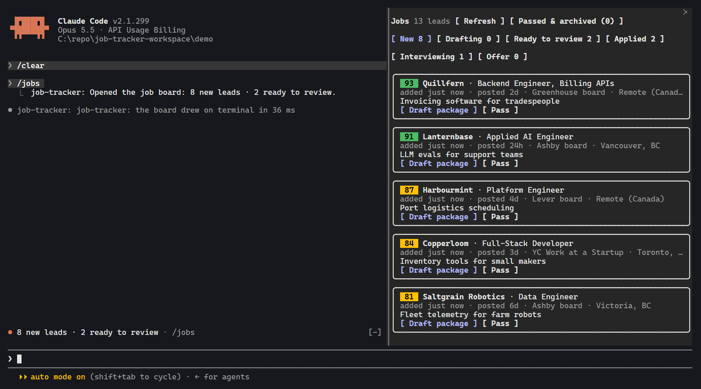
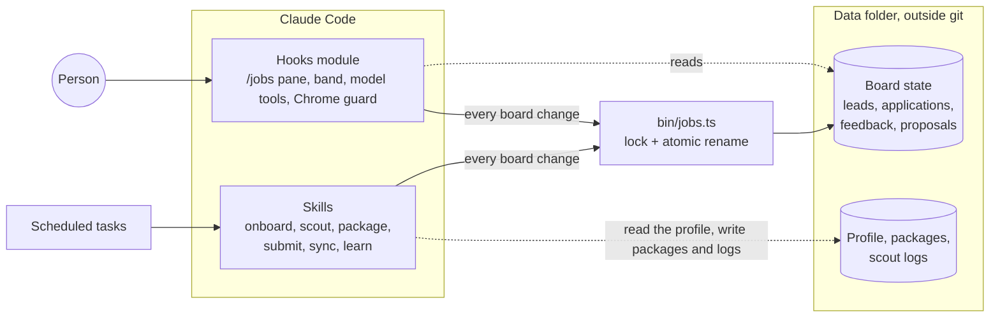

# job-tracker

A job search that runs inside [Claude Code](https://code.claude.com). Scheduled agents find
postings and score them against written preferences. One click builds a tailored application
package. The final submit is held for the person's yes in chat. The person's passes, edits and
outcomes then feed a weekly review that proposes changes to how the next postings are scored and
written.

It is a working personal tool, not a product. It is public as a worked example of agents carrying
a messy, real workflow: they do the reading and the drafting, one small CLI owns the state, and a
person makes the decisions that reach the outside world.



_A real capture of the mod in Claude Code's terminal, showing invented companies. The desktop app
draws the same pane._

Built on Claude Code. Not affiliated with or endorsed by Anthropic.

## What it does

- **Onboard** runs once. An interview builds the person's profile from a résumé, writing samples
  and their answers, and every other stage works from that record.
- **Scout** runs on a schedule. Parallel subagents read public Greenhouse, Lever and Ashby boards,
  local job boards and careers pages, job-alert emails, web search and HN Who's Hiring. Postings
  that score under 70 or are dated over 14 days ago stay off the board.
- **Score** is 0-100 against the person's written preferences, with a one-line reason. Scores never
  decay with age; a New lead is archived once its posting is over 14 days old instead. The person
  can mark a score too high or too low on the lead's page.
- **Package** runs in a background subagent. It builds a résumé from approved wording only, with a
  source line for every bullet, then a cover letter, answers to the posting's questions, a company
  brief and a warm-intro search. A warm intro can become a Gmail draft, never a sent email. The
  person reviews each file on the board.
- **Submit** starts with a background subagent that fills in the form in Chrome and uploads the
  PDF. The conversation then asks, in one message, for anything the record does not answer, shows
  what was entered and asks whether to submit. Each answer is saved word for word, so a question
  answered once is not asked again where that answer applies. Sign-ins, passwords, CAPTCHAs and
  agreements go back to the person.
- **Sync** reads Gmail and Calendar for replies, rejections, interviews and offers, and proposes
  moves in a table. No card moves until the person confirms.
- **Learn** runs weekly. It reads passes, score corrections, edits to drafted packages and outcomes
  by source, and proposes up to ten small changes, each backed by at least two events. Each change
  is approved or rejected on its own.

An application with no reply a month after it was submitted is marked ghosted on its own, and a
late reply still moves the card on.

## How it is built



- **Skills** (`skills/*/SKILL.md`) are the agents' instructions, written in plain Markdown.
- **The hooks module** (`hooks/register.tsx`, `hooks/views.tsx`) is TypeScript that runs inside the
  engine. It draws the pane and band, registers the tools the model calls, and guards Chrome calls.
- **The CLI** (`bin/jobs.ts`) is the only writer of the board's state files. Skills and the pane
  both call it, so scheduled runs and clicks cannot overwrite each other.
- **Pure logic** lives in `hooks/lib/model.ts`: board moves, feedback events, ageing rules and
  counts touch no files. The same functions run in the CLI and the tests.
- **Personal data** lives in a folder named by `JOB_TRACKER_DATA`, outside every repository.

[SETUP.md](SETUP.md) has the configuration, the data folder's layout and daily use.

## Engineering notes

- **Concurrent writers, one lock.** A scheduled scout, a background package build and a click on
  the board can all land at once. `bin/lib/store.ts` takes a lock file, reads, applies a pure
  function and renames a temporary file over the old one. It recovers stale locks and retries the
  renames Windows refuses while a file is briefly held open.
- **A code guard backs the human gate where an agent works unattended.** The submit skill stops and
  asks in chat. Background prefills also pass a guard (`hooks/lib/chrome.ts`) that limits them to
  tabs they opened, requires an element ref for every click, reads each element first, and refuses
  a click on anything labelled or typed like a final submit. It exists because one prefill's clicks
  once landed in another's tab and sent an application nobody approved. The mod now also looks for
  a stray submit when a prefill ends, and raises it first in the conversation.
- **No invented résumé facts.** The package skill may shorten or reorder approved wording, but not
  broaden it, and every bullet is traced to its source. This rule is enforced by the skill's
  instructions and a source list the person can check, not by code.
- **Personal data is kept out by a check, not by habit.** `npm run check:personal-data` fails on
  document files, data-folder paths, phone numbers, email addresses and LaTeX documents. With the
  data folder present it also checks for the exact identity values in the local profile. CI runs
  it along with a gitleaks scan of the full history.
- **Coverage floors in the test command.** `npm test` fails if total coverage of the modules it
  loads from `hooks/lib` and `bin/lib` drops under 95% lines, 90% branches or 95% functions,
  enforced by Node's built-in test runner. `hooks/lib/io.ts` needs the engine, so the plugin tests
  exercise it and it sits outside that number.
- **Tests go through the engine.** `claude plugin test` mounts the real pane and band on the
  terminal, desktop and mobile surfaces. `claude plugin validate` reads the module the way the
  engine will, and CI fails if a hook matcher is not a literal the engine can read.
- **TypeScript with no build step.** Node 24 runs the CLI directly and the engine compiles the
  hooks module at load.

## Install

Open [INSTALL.md](INSTALL.md), copy its address, open Claude Code in the Claude desktop app, and
say:

> Read INSTALL.md at <the address you copied> and set this up for me.

It walks Claude through everything outside the code, and the `onboard` skill builds your profile
from your résumé, your writing and a short interview.

To look at an empty board first, with Node 24+ and Claude Code:

```bash
git clone https://github.com/NathanPannell/job-tracker.git
```

```bash
cd job-tracker
```

```bash
node bin/jobs.ts init --data ../job-tracker-data
```

```bash
JOB_TRACKER_DATA="$PWD/../job-tracker-data" JOB_TRACKER_HOME="$PWD" claude --plugin-dir .
```

Then run `/jobs` in that session. To work on the code:

```bash
npm ci
```

```bash
npm run types:engine
```

```bash
npm run ci
```

## Status and limits

- It was built for and is used by one person. There is no marketplace package and no sample data,
  and nothing useful happens until the `onboard` interview has written a profile.
- Some parts are tied to that one search. `bin/lib/ats.ts` hard-codes a BC and Canada location
  filter. Setting `ATS filter: outside Canada` in `preferences.md` makes scout skip it and judge
  location itself. `bin/lib/gmail.ts` lists BC newsletters among its sources.
- Scores are a model's judgement against a written rubric. They have not been measured against
  outcomes, and the funnel in the weekly review is the only feedback on them.
- The Chrome guard reads labels and button types, so a final button with an unusual label can get
  past it; the stray-submit check is the backstop. It covers background prefills, and otherwise
  only keeps the conversation out of tabs a prefill is using. The submit rule in the conversation
  itself is an instruction to the model.
- A posting with no usable date is added, and its age then counts from when it reached the board.
- The mod relies on Claude Code's plugin API, which is marked early access and may change between
  releases.
- It is used on Windows, and CI runs on Linux. macOS has not been tried.
- On mobile the board and packages are view-only.

## License

[MIT](LICENSE), for this repository's own code. Claude Code is not part of it: the engine's type
declarations are generated locally and are not distributed here, though commits before this
change contain a copy of them (`vendor/claude-code.d.ts`). That file is Anthropic's and was never
covered by this license.
